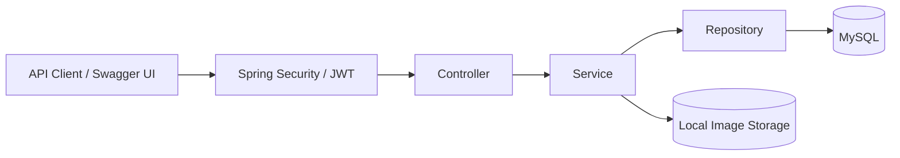

# News Management REST API

**API quản lý tin tức với JWT, quyền tác giả và kho ảnh local.**


[](docs/TESTING.md)

Backend Spring Boot cung cấp API đọc tin công khai, quản lý bài viết theo tài khoản và xử lý ảnh JPEG, PNG, WebP. Khám phá và gọi API trực tiếp qua Swagger UI.

[Thiết lập](docs/SETUP.md) · [API Reference](docs/API.md) · [Testing](docs/TESTING.md) · [Security](docs/SECURITY.md)

## Tính năng

- **Tài khoản:** đăng ký, đăng nhập và xác thực JWT Bearer.
- **Tin tức:** tạo, đọc, cập nhật, xóa; chỉ tác giả được sửa hoặc xóa bài của mình.
- **Tìm kiếm:** tìm trong tiêu đề/nội dung, lọc danh mục, sắp xếp và phân trang.
- **Ảnh:** upload tối đa 5 MB, truy cập công khai, gán vào bài viết và xóa khi không còn được tham chiếu.
- **API documentation:** OpenAPI với schemas, examples và Swagger UI.

## Tech Stack

| Thành phần | Công nghệ |
| --- | --- |
| Runtime & build | Java 21 · Maven |
| Backend | Spring Boot 3.5.16 · Spring Web · Bean Validation |
| Persistence | Spring Data JPA · Hibernate · MySQL 8 |
| Authentication | Spring Security · JJWT 0.13.0 · BCrypt |
| Images | Java ImageIO · TwelveMonkeys WebP 3.15.0 · filesystem local |
| API docs | springdoc-openapi 2.8.17 · Swagger UI |
| Testing | JUnit 5 · Mockito · MockMvc · HTTP E2E với MySQL thật |

## Kiến trúc



Request được validate qua DTO; API JSON dùng response thống nhất `{success, message, data}`. Xem [cấu trúc dự án](docs/SETUP.md#cấu-trúc-dự-án) và [quy ước API](docs/API.md#swagger-ui-và-response).

## Quick Start

1. Chuẩn bị **Java 21, Maven 3.6.3+ và MySQL 8**.
2. Tạo database `news_management` và cấu hình `DB_URL`, `DB_USERNAME`, `DB_PASSWORD`, `JWT_SECRET` theo [hướng dẫn thiết lập](docs/SETUP.md#khởi-động-local).
3. Từ thư mục repository, chạy:

```shell
mvn spring-boot:run
```

Mở [Swagger UI](http://localhost:8080/swagger-ui.html) → Register → Login → **Authorize** bằng access token. Địa chỉ trên dùng cổng mặc định `8080`.

## API Overview

API có prefix `/api/v1`, ngoại trừ đường dẫn đọc ảnh.

| Nhóm | Method | Endpoint | Quyền |
| --- | --- | --- | --- |
| Auth | POST | `/api/v1/auth/register`, `/api/v1/auth/login` | Public |
| News | GET | `/api/v1/news`, `/api/v1/news/{id}` | Public |
| Search | GET | `/api/v1/news/search` | JWT |
| News | POST | `/api/v1/news` | JWT |
| News | PUT / DELETE | `/api/v1/news/{id}` | JWT + tác giả |
| Images | POST | `/api/v1/news/upload-image` | JWT |
| Images | GET | `/uploads/{filename}` | Public |
| Images | DELETE | `/api/v1/news/images/{filename}` | JWT |

Request fields, query parameters, responses và cách sử dụng ảnh được mô tả trong [API Reference](docs/API.md).

## Testing

Chạy automated tests không cần MySQL local:

```shell
mvn clean verify
```

Chạy thêm HTTP E2E với database MySQL riêng trên Windows PowerShell:

```powershell
powershell -NoProfile -ExecutionPolicy Bypass -File .\scripts\run-e2e.ps1
```

E2E cần database `news_management_e2e` và cấu hình DPAPI ngoài repository. Xem [điều kiện và hướng dẫn chạy](docs/TESTING.md#e2e-với-mysql-thật). Lần kiểm chứng ngày **11/10/2026**: **97 automated tests + 5 E2E PASS**; badge là kết quả ghi nhận, không phải trạng thái CI trực tiếp.

## Tài liệu

| Tài liệu | Nội dung |
| --- | --- |
| [Setup](docs/SETUP.md) | Môi trường, database, biến cấu hình và chạy local |
| [API Reference](docs/API.md) | Endpoints, validation, Swagger, responses và vòng đời ảnh |
| [Testing](docs/TESTING.md) | Automated tests, MySQL E2E và báo cáo kết quả |
| [Security](docs/SECURITY.md) | JWT, quyền truy cập, lưu trữ ảnh và giới hạn hiện tại |
